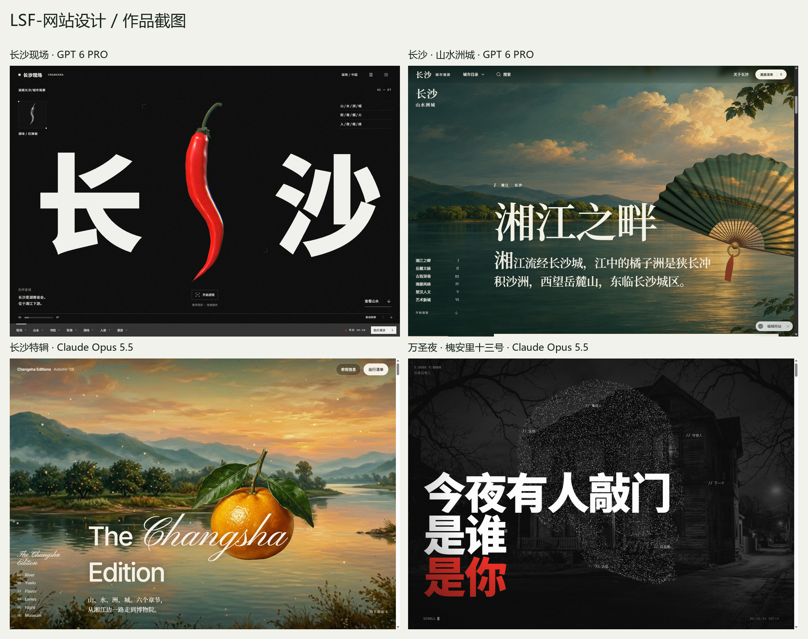
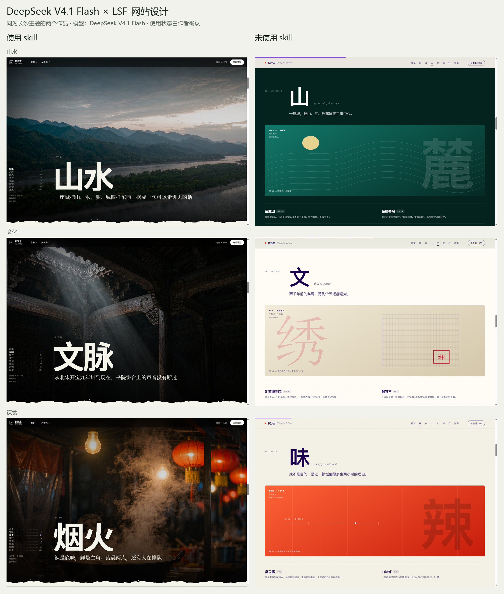

# LSF-网站设计 · 基础版


[](LICENSE)

给 AI 编程助手使用的网站设计 skill：从参考站研究、版式与动效制作，到实际浏览器核验和独立评审。

支持风格参考、原创探索、找参考、反推提示词和成品评审。规则、模板和脚本按任务读取。



## DeepSeek：使用与未使用 skill

两边模型均为 **DeepSeek V4.1 Flash**，主题均为长沙。使用状态由作者确认，左侧使用 `lsf-website-design`，右侧未使用 skill。



| 作品 | 模型 | skill 使用情况 | 原始样本 | 长图 |
|---|---|---|---|---|
| 长沙志 · 冬 2026 | DeepSeek V4.1 Flash | 使用 LSF-网站设计 | `000e433564488284` | [查看截图](examples/screenshots/deepseek-with-skill.jpg) |
| 长沙志 · 城市版本 | DeepSeek V4.1 Flash | 未使用 skill | `c73a2a18a05ddb58` | [查看截图](examples/screenshots/deepseek-without-skill.jpg) |

截图来自作者提供的两个本地成品，按山水、文化、饮食三个主题对应排列。未取得相同提示词、参数及完整生成记录，因此这是一组成品展示，不能据此作严格受控评测的结论。

## 更多作品

| 作品 | 在线体验 | 模型 | 场景长图 |
|---|---|---|---|
| 长沙现场 | [打开作品](https://changsha-city-fieldnotes.leir0491.chatgpt.site/#intro) | GPT 6 PRO | [现场 / 山水 / 湘味 / 入夜](examples/screenshots/changsha-fieldnotes.jpg) |
| 长沙 · 山水洲城 | [打开作品](https://changsha-city-edition-v34.leir0491.chatgpt.site/#xiangjiang) | GPT 6 PRO | [开场 / 湘江 / 风味](examples/screenshots/changsha-edition.jpg) |
| 万圣夜 · 槐安里十三号 | [打开 Hark 作品](https://hark.com/site/6ea9e899-ceba-4306-966c-0622f3f47ee8?hark_region=us) | Claude Opus 5.5 | [开场 / 档案 / 轮播 / 球体](examples/screenshots/hark-halloween.jpg) |
| 长沙特辑 · The Changsha Edition | [打开 Hark 作品](https://hark.com/site/77af0857-a085-4f73-9456-4db0641e3a45?hark_region=us) | Claude Opus 5.5 | [开场 / 湘江 / 岳麓 / 小吃](examples/screenshots/hark-changsha-edition.jpg) |

全部为实际页面截图，长图由多个场景拼接。截图时间：2026-11-04；单屏视口：1440 × 1000。模型信息以作者提供的记录为准，不根据托管平台推断。详细来源见[作品展示](examples/作品展示.md)和[截图记录](examples/screenshots/manifest.json)。

## 安装

可以让支持本地 skill 的 AI 助手执行：

```text
从 https://github.com/leishifu666/lsf-website-design 安装 lsf-website-design。
保留目录结构；如果已有安装或本地定制，先检查，不要直接覆盖。
按 references/首次安装与依赖.md 检查配套组件。
```

也可以克隆到宿主的技能目录，文件夹命名为 `lsf-website-design`。例如在采用 `~/.agents/skills` 的环境中：

```bash
git clone https://github.com/leishifu666/lsf-website-design.git ~/.agents/skills/lsf-website-design
```

Windows 可使用 `%USERPROFILE%\.agents\skills\lsf-website-design`；实际发现路径以宿主配置为准。仓库根目录包含 `SKILL.md`，不要只复制这一个文件。安装后按宿主要求刷新技能列表或开启新会话。

## 怎么用

在支持 `$skill-name` 的宿主中指定 `$lsf-website-design`；其他宿主可直接要求读取本技能的 `SKILL.md`。

```text
使用 $lsf-website-design，参考 https://example.com 的设计，为长沙制作一个城市展示网站。
主题、图片、文案和交互按长沙重新组织，在当前项目实现并验证。
```

```text
使用 $lsf-website-design，评审这个已有页面的视觉效果和交互，本次只评审，不改代码。
```

```text
使用 $lsf-website-design，分析这个参考网站并反推完整建站提示词，本次只分析，不写网站代码。
```

## 工作方式

网站设计主技能，规则入口为[SKILL.md](SKILL.md)。AI自动判断A/B/C/D/F/G/H 七种基础模式，普通建站默认贴近参考风格；A参考默认由当前对话主Agent直接制作一套，用户想比较时才先做三个预览；三份使用同一提示词、主题和主参考。C原创探索保留三个产品方向，按用户本次范围执行。统一制作模板见[风格参考提示词](templates/风格参考统一提示词.md)。网页新素材用Codex内置生图，趣味动效先找真实网站和开源源码，视觉评审优先Gemini/Claude并通过Ego Lite现场取证。

A 模式从[实际制作提示词](templates/风格参考统一提示词.md)与[原站侦察命令](references/原站侦察与回放.md)进入。先实测六类行为并锁定原站，再做一个可操作样段。样段对照通过后才展开整站，三阶段的命令与证据见[取证格式](references/A模式证据格式.md)。

## 首次安装的三个必备免费组件

处理“安装本技能”的Agent应自动读取[首次安装与依赖](references/首次安装与依赖.md)，检查并告知以下三项；缺项时给链接并按用户授权协助安装，已有定制不能覆盖。该提醒仅在首次安装交接触发，不重复打扰日常使用。

- [lsf-ai-agent skill](https://github.com/leishifu666/lsf-ai-agent)：多模型调度
- [ego-browser skill](https://github.com/citrolabs/ego-lite/tree/main/skills/ego-browser)：浏览器操作规则
- [Ego Lite浏览器](https://lite.ego.app/)：真实浏览器，安装后通常自动加入ego-browser skill

三者本身免费；上游模型服务的账号、额度或订阅按各自条件。完整安装规则、验证与GUI边界见首次安装说明。

## 模式

| 模式 | 适用任务 |
|---|---|
| A 风格参考（默认） | 给定参考与新主题，制作网站 |
| B 参考创作 | 只迁移参考中的适用设计方法 |
| C 原创探索 | 探索原创产品和构图方向 |
| D 寻找参考 | 查找、比较真实网站参考 |
| F 反推提示词 | 分析参考，交付建站及素材提示词 |
| G 视觉评审 | 对已有页面独立取证和评审 |
| H 文案评审 | 检查成品的文案冗余与用途 |

`lsf-web-*`调用名保留兼容，薄入口可按[脚本说明](scripts/README.md)生成。仅分析、提示词、评审不自动串联网站制作。子代理、外部模型、图片生成和浏览器能力以宿主实际提供为准；本技能不自带模型服务或 API 密钥。

## 按需读取与维护

从[模式与阶段导航](references/模式阅读导航.md)选当前资料，[总索引](INDEX.md)覆盖全部资源。大文档的专题源文件按场景拆分，旧链接继续指向对应章节。`node scripts/read-plan.mjs --mode A --stage preview`只查询，不执行制作。

维护`references/资源路由.json`及专题源文件后运行`node scripts/resource-index.mjs`；`--check`检查索引是否同步。薄入口由`install-mode-entries.mjs`生成，不手改生成文件。

脚本依赖和运行方式见[scripts/README.md](scripts/README.md)。发布本版时，70 项 Node 回归测试与资源索引校验通过；测试覆盖脚本契约，不代表所有外部网站、模型渠道或宿主均已验证。

## 开源许可

本仓库的原创技能文档和脚本采用 [MIT License](LICENSE)，允许使用、修改和分发。第三方组件、字体、网站素材和商标遵循各自许可；作品截图用于展示输出效果，不代表其素材另行授予 MIT 许可。
