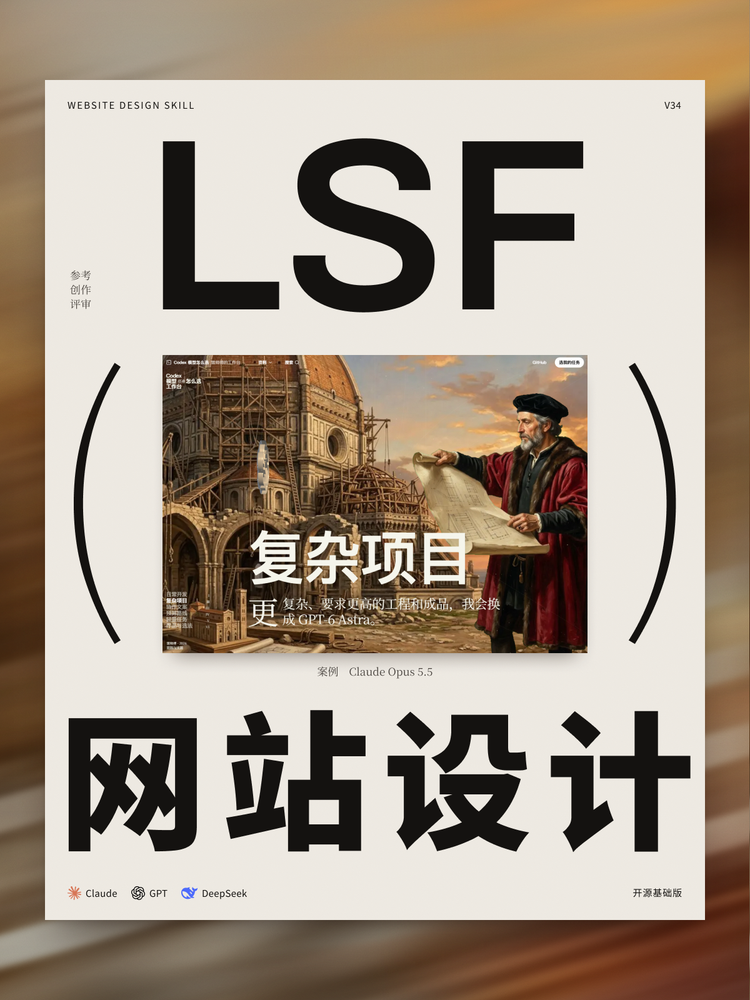
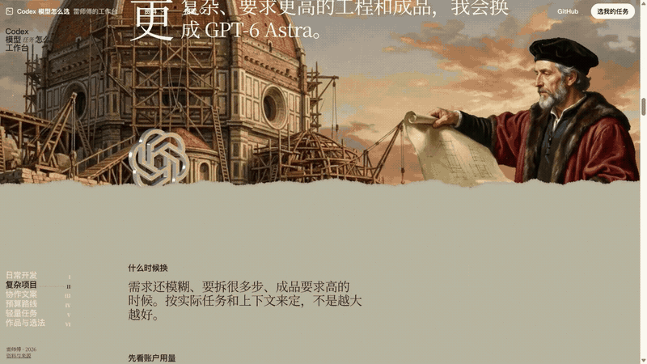
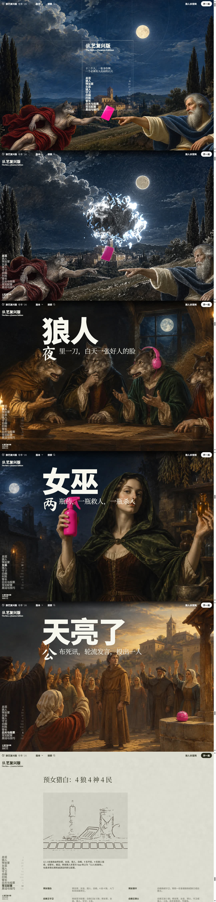
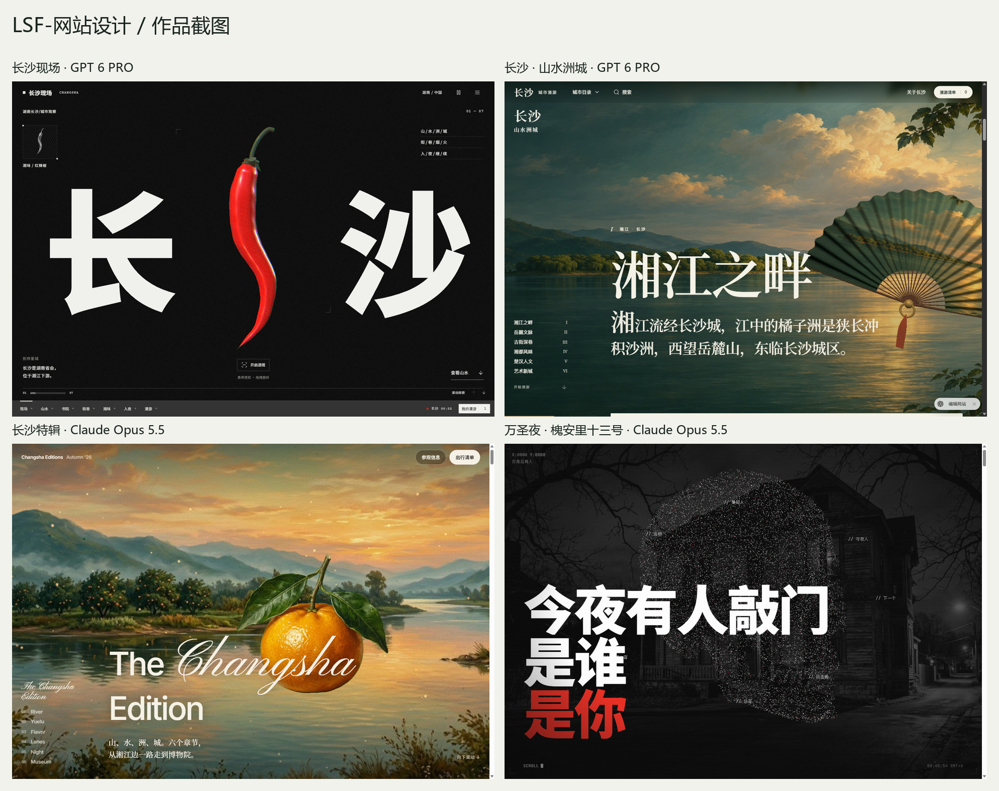

<p align="center">
  
</p>

# LSF-网站设计 · 基础版


[](LICENSE)

LSF-网站设计是一套给 AI 编程助手用的网站设计技能。给它一个主题，可以开始做新网站。再附上一个参考网址，它会先研究原站的布局和交互，再为你的主题设计和制作。

你也可以单独请它找设计参考、从参考站整理建站提示词，或评审已有页面。下面是实际作品和可以直接复制的使用示例。

## 作品展示

### 置顶案例：Codex 模型怎么选

**制作模型为 Claude Opus 5.5。** 这是雷师傅目前最满意的作品之一。

[在线体验](https://hark.com/site/6987019b-6557-46da-bf40-a0ed2d58dcfe?hark_region=us) · [观看 / 下载约 39 秒录屏](https://github.com/leishifu666/lsf-website-design/raw/refs/heads/main/examples/videos/codex-model-guide.mp4) · [15 张独立截图](examples/screenshots/codex-model-guide) · [九个场景长图](examples/screenshots/codex-model-guide-long.jpg)

[](https://hark.com/site/6987019b-6557-46da-bf40-a0ed2d58dcfe?hark_region=us)

六个章节分别展示日常开发、复杂项目、协作文案、预算路线、轻量任务与作品选择。页面包含场景转场、章节导航、任务与偏好选择、模型搜索。下面的动态预览来自实际操作录屏，点击可查看完整 MP4。

[](https://github.com/leishifu666/lsf-website-design/raw/refs/heads/main/examples/videos/codex-model-guide.mp4)


无配音录屏展示六章切换、正文、任务推荐和 DeepSeek 搜索。GIF 是约 10 秒的加速节选，长图由实际页面截图拼接。[更多截图、交互说明及来源](examples/作品展示.md#置顶案例codex-模型怎么选)

### DeepSeek：使用与未使用 skill

两份长沙主题作品都由 **DeepSeek V4.1 Flash** 制作。左侧用了 `lsf-website-design`，右侧未使用，使用情况由作者确认。


| 作品 | 模型 | skill 使用情况 | 原始样本 | 长图 |
|---|---|---|---|---|
| 长沙志 · 冬 2026 | DeepSeek V4.1 Flash | 使用 LSF-网站设计 | `000e433564488284` | [查看截图](examples/screenshots/deepseek-with-skill.jpg) |
| 长沙志 · 城市版本 | DeepSeek V4.1 Flash | 未使用 skill | `c73a2a18a05ddb58` | [查看截图](examples/screenshots/deepseek-without-skill.jpg) |

可以按**山水、文化、饮食**三个板块对照版式和视觉层次。截图来自作者提供的两个本地成品。两次制作的提示词、参数和完整过程无法一一核对，因此这组图片仅用于展示成品。

### 更多作品与总览

| 作品 | 在线体验 | 模型 | 场景长图 |
|---|---|---|---|
| 山水洲城 · 长沙漫游 | [打开作品](https://changsha-shanshui-edition-2026.leir0491.chatgpt.site/#overview) | GPT6 Pro | [开场 / 湘江 / 岳麓 / 寻味 / 入夜](examples/screenshots/changsha-shanshui-roam.jpg) |
| 长沙现场 | [打开作品](https://changsha-city-fieldnotes.leir0491.chatgpt.site/#intro) | GPT6 Pro | [现场 / 山水 / 湘味 / 入夜](examples/screenshots/changsha-fieldnotes.jpg) |
| 长沙 · 山水洲城 | [打开作品](https://changsha-city-edition-v34.leir0491.chatgpt.site/#xiangjiang) | GPT6 Pro | [开场 / 湘江 / 风味](examples/screenshots/changsha-edition.jpg) |
| 万圣夜 · 槐安里十三号 | [打开 Hark 作品](https://hark.com/site/6ea9e899-ceba-4306-966c-0622f3f47ee8?hark_region=us) | Claude Opus 5.5 | [开场 / 档案 / 轮播 / 球体](examples/screenshots/hark-halloween.jpg) |
| 长沙特辑 · The Changsha Edition | [打开 Hark 作品](https://hark.com/site/77af0857-a085-4f73-9456-4db0641e3a45?hark_region=us) | Claude Opus 5.5 | [开场 / 湘江 / 岳麓 / 小吃](examples/screenshots/hark-changsha-edition.jpg) |
| 狼艺复兴版 · 狼人杀 | [打开 Hark 作品](https://hark.com/site/533df3ba-5c81-45b2-9d92-50281fb04326?hark_region=us) | Claude Opus 5.5 | [开场 / 转场 / 狼人 / 女巫 / 投票 / 配置](examples/screenshots/hark-renwolfssance.jpg) |

#### 狼艺复兴版 · 狼人杀



长图由实际页面截图拼接。截图拍摄于 2026-11-04、2026-11-19 和 2026-11-20，桌面视口为 1440 × 1000。置顶案例另含 375 × 812 手机截图和 1440 × 810 录屏。模型信息来自作者提供的记录。详细来源见[作品展示](examples/作品展示.md)和[截图记录](examples/screenshots/manifest.json)。



## 模式

公开基础版有 A、B、C、D、F、G、H、I、J 九种模式。AI 会根据你的指令选择。

| 模式 | 适用任务 |
|---|---|
| A 风格参考（默认） | 给定参考与新主题，制作网站 |
| B 参考创作 | 只迁移参考中的适用设计方法 |
| C 原创探索 | 探索原创产品和构图方向 |
| D 寻找参考 | 查找、比较真实网站参考 |
| F 反推提示词 | 分析参考，交付建站及素材提示词 |
| G 视觉评审 | 对已有页面独立取证和评审 |
| H 文案评审 | 检查成品的文案冗余与用途 |
| I 复刻动画 | 复刻指定动画、交互或录屏片段，并逐帧对照 |
| [J DESIGN.md](references/design-md.md) | 从项目或网址提取设计规范，按需生成七章交互 HTML 预览 |

可以继续使用 `lsf-web-*` 调用名，生成兼容入口的方法见[脚本说明](scripts/README.md)。分析、反推提示词或评审任务会交付对应结果。子代理、模型、生图和浏览器能力由你使用的 AI 工具提供，选用 API 时使用自己的凭据。

## 安装

可以把下面这段安装指令交给支持本地 skill 的 AI 助手。

```text
从 https://github.com/leishifu666/lsf-website-design 安装 lsf-website-design。
保留目录结构；如果已有安装或本地定制，先检查，不要直接覆盖。
按 references/首次安装与依赖.md 检查配套组件。
```

也可以把仓库克隆到你的 AI 工具的技能目录，文件夹命名为 `lsf-website-design`。以下命令适用于使用 `~/.agents/skills` 的环境。

```bash
git clone https://github.com/leishifu666/lsf-website-design.git ~/.agents/skills/lsf-website-design
```

Windows 可使用 `%USERPROFILE%\.agents\skills\lsf-website-design`，具体路径以 AI 工具的配置为准。安装时请保留 `SKILL.md` 和仓库目录结构。安装后按宿主要求刷新技能列表或开启新会话。

### 首次安装的三个必备免费组件

首次安装时，AI 助手会按[首次安装与依赖](references/首次安装与依赖.md)检查以下三项。有缺项时，它会提供链接，并在你授权后协助安装，保留已有本地定制。

- [lsf-ai-agent skill](https://github.com/leishifu666/lsf-ai-agent)：多模型调度
- [ego-browser skill](https://github.com/citrolabs/ego-lite/tree/main/skills/ego-browser)：浏览器操作规则
- [Ego Lite浏览器](https://lite.ego.app/)：真实浏览器，安装后通常自动加入 ego-browser skill

这三个组件免费。模型服务的账号、额度和订阅按各个平台的规则使用。

### 首版制作的模型建议

以下是雷师傅给出的首版制作建议。可用型号和入口以你使用的平台为准。

| 方案 | 模型 | 说明 |
|---|---|---|
| 推荐首选 | **Claude Opus 5.5、GPT 6 Ultra、GPT 6 Pro** | 推荐用来制作网站的第一版 |
| 平替方案 | **DeepSeek V4.1 Flash** | 可用真实项目试做，仓库已有其成品展示 |
| 待测方案 | **Kimi K3.1** | 雷师傅尚未测试，欢迎大家测试后提交案例，帮助完善仓库 |

欢迎通过 Issue 或 PR 分享 **Kimi K3.1** 的实测案例。请提供实际入口、模型名称、技能版本、任务和参考网址，附成品链接或截图和可复现的记录。有耗时和用量数据也可以一起附上。提交前请移除密钥和账号凭据。

## 怎么用

在支持 `$skill-name` 的宿主中指定 `$lsf-website-design`；其他宿主可直接要求读取本技能的 `SKILL.md`。

**参考网站制作整站**

```text
使用 $lsf-website-design，参考 https://example.com 的设计，为长沙制作一个城市展示网站。
主题、图片、文案和交互按长沙重新组织，在当前项目实现并验证。
```

**只做视觉与交互评审**

```text
使用 $lsf-website-design，评审这个已有页面的视觉效果和交互，本次只评审，不改代码。
```

**只分析参考站并反推提示词**

```text
使用 $lsf-website-design，分析这个参考网站并反推完整建站提示词，本次只分析，不写网站代码。
```

**复刻一段动画**

```text
使用 $lsf-web-animate，把参考页的首屏滚动转场做进当前项目，采集原效果并逐帧对照。
```

模式 I 从主技能自动分流。想直接指定模式 I，可以用 [入口生成器](scripts/README.md)安装 `lsf-web-animate`。

## 工作方式

AI 助手按 [SKILL.md](SKILL.md) 里的规则判断任务。普通建站默认走 A 模式，贴近参考风格。下面是这个模式的做法。统一任务写法见[风格参考统一提示词](templates/风格参考统一提示词.md)。

1. **先看参考站。** 实际操作原站，检查六类交互，并确认主要页面的布局、点击和滚动表现。具体怎么查，见[原站侦察命令](references/原站侦察与回放.md)。
2. **做一段能操作的样板。** 默认由当前 AI 助手做一套。你明确想比较方案时，才用同一提示词、主题和参考站做三个预览。
3. **对上参考后做完整网站。** 样板核对通过后再展开整站。三阶段的命令和验收要求见[取证格式](references/A模式证据格式.md)。

模式 A 制作整站时，如果参考页有核心动效，会用[模式 I 的取证和逐帧对照流程](references/动画取证与逐帧对照.md)，把证据接回整站的样段和最终核对。只做指定动画或视频片段时，直接用[模式 I](references/复刻动画.md)。

C 模式会探索三个原创方向，实际交付按你指定的范围执行。

新图默认由当前 AI 助手的内置工具生成，也可以按你的选择使用 API。透明素材交付前会检查实际的透明像素。做动效时优先找真实网站和开源实现。视觉评审优先用 Gemini 或 Claude，并在 Ego Lite 里检查实际页面。

## 按需读取与维护

从[模式与阶段导航](references/模式阅读导航.md)找到当前任务所需的资料，也可以用[总索引](INDEX.md)查找全部资源。以下命令用来查询 A 模式在预览阶段需要读取的资料。

```bash
node scripts/read-plan.mjs --mode A --stage preview
```

维护 `references/资源路由.json` 或专题源文件后，分别用以下命令更新和校验资源索引。

```bash
node scripts/resource-index.mjs
node scripts/resource-index.mjs --check
```

兼容入口通过 `install-mode-entries.mjs` 生成。脚本依赖、运行方法和回归测试命令见[脚本说明](scripts/README.md)。回归测试覆盖脚本行为，外部网站、模型和宿主能力以实际使用为准。

## 开源许可

本仓库的原创技能文档和脚本采用 [MIT License](LICENSE)，允许使用、修改和分发。第三方组件、字体、网站素材和商标遵循各自许可。作品截图用于展示成品，截图内的素材使用遵循原许可。
