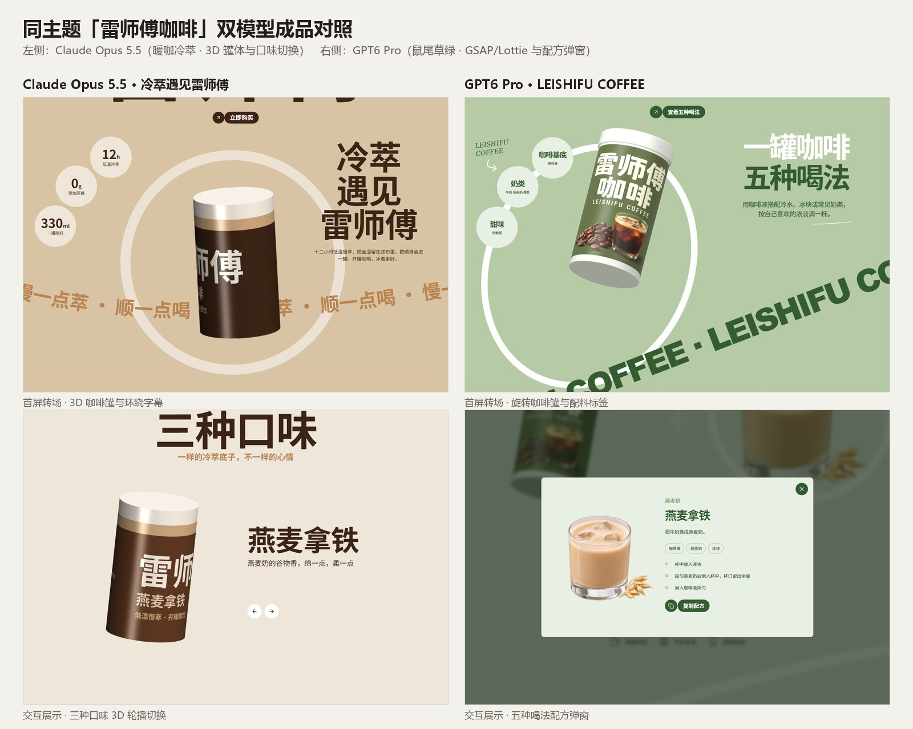
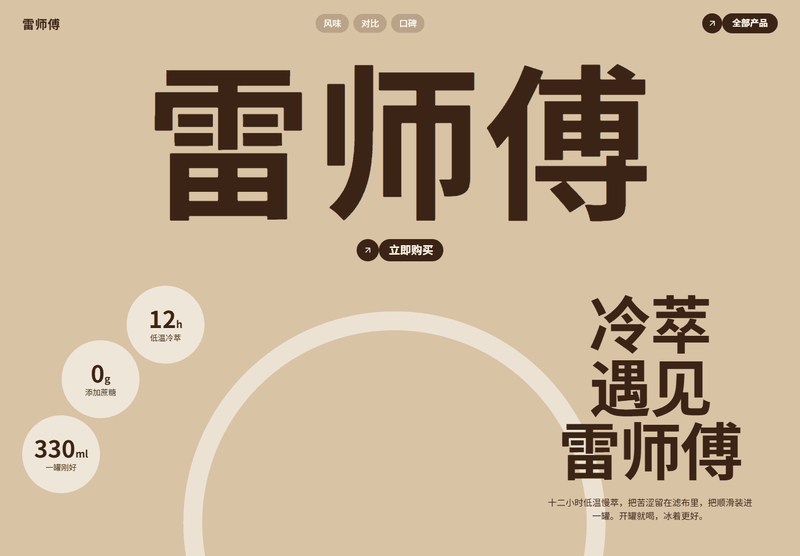
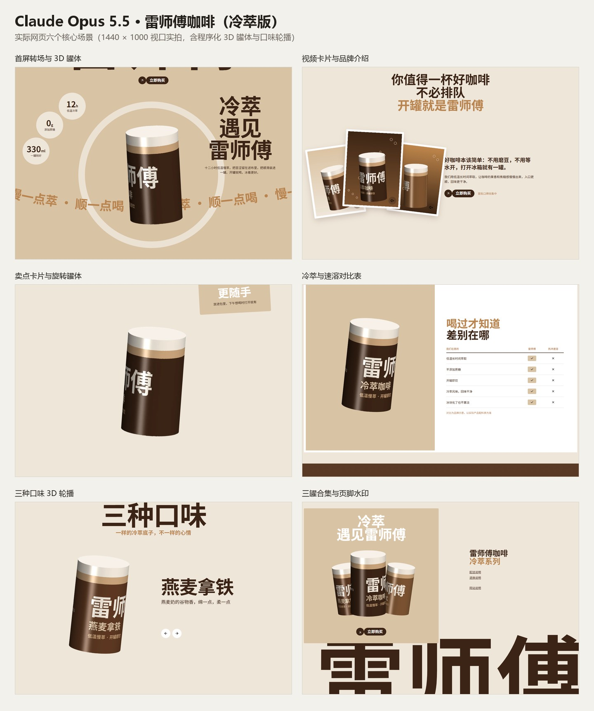

<p align="center">
  
</p>

# LSF-网站设计 · 基础版


[](LICENSE)

**给 AI 编程助手用的网页设计与工程交付技能**：让 AI 告别千篇一律的“默认模板脸”，从真实参考站侦察、交互与源码组件复用，到动画逐帧复刻与独立浏览器评审，交付真正达到上线水准的网页作品。

给它一个主题就能从零开始；再附上一个参考网址，它会先拆解原站的版式节奏、设计令牌与核心动效，再围绕你的主题重新设计并实现。也可以单独用来找设计参考、反推建站提示词、提取 `DESIGN.md` 设计规范，或评审已有页面。

[核心模式](#模式与能力) · [作品展示](#作品展示) · [快速安装](#安装) · [模型建议](#首版制作的模型建议) · [使用示例](#怎么用) · [工作方式](#工作方式)

---

## 为什么用 LSF-网站设计

- **先看真站再动手**：脚本自动侦察参考站 DOM、CSS 变量、字体、媒体与动效机制（WebGL / GSAP / CSS Scroll），拒绝凭印象臆造。
- **反同质化与源码复用**：内置[反套路清单](references/反套路清单.md)与开源组件源码复用核查，避免 AI 堆砌“居中大标题 + 三栏卡片 + 渐变按钮”。
- **动效逐帧复刻与核验**：支持复刻网页或录屏中的指定交互与 Three.js / Canvas / WebGL 效果，采集并逐帧对比，不以静态兜底冒充动态交付。
- **独立盲评与浏览器实测**：支持在真实浏览器（Ego Lite / Playwright）取证检查排版、无障碍、多端响应式与文案冗余。
- **一键提取 `DESIGN.md`**：内置模式 J，可从现成网站或代码库提取设计规范并生成交互预览。

---

## 作品展示

> 全部展示图片与 GIF 均来自真实浏览器（`1440 × 1000` 等视口）实拍或连续操作录屏，未经重绘。完整目录与各图来源见 [作品展示详细页](examples/作品展示.md) 与 [manifest.json](examples/screenshots/manifest.json)。

### 1. 置顶案例：Codex 模型怎么选

**制作模型：Claude Opus 5.5**（雷师傅目前最满意的作品之一）

[在线体验](https://hark.com/site/6987019b-6557-46da-bf40-a0ed2d58dcfe?hark_region=us) · [观看 / 下载约 39 秒录屏 (MP4)](https://github.com/leishifu666/lsf-website-design/raw/refs/heads/main/examples/videos/codex-model-guide.mp4) · [15 张独立截图](examples/screenshots/codex-model-guide) · [九个场景长图](examples/screenshots/codex-model-guide/long.jpg)

[](https://hark.com/site/6987019b-6557-46da-bf40-a0ed2d58dcfe?hark_region=us)

六个章节涵盖日常开发、复杂项目、协作文案、预算路线、轻量任务与作品选择，内置章节转场、任务偏好选择器与模型搜索。下方 GIF 为约 10 秒加速节选，点击可查看完整 MP4：

[](https://github.com/leishifu666/lsf-website-design/raw/refs/heads/main/examples/videos/codex-model-guide.mp4)


---

### 2. 新增案例 · 同主题双模型对照：雷师傅咖啡（Claude Opus 5.5 vs GPT6 Pro）

两份作品均以「**雷师傅咖啡**」为同一主题、参照同类立体罐装交互参考制作，分别由 **Claude Opus 5.5** 与 **GPT6 Pro** 独立生成，可直接对比两大旗舰模型在视觉体系、3D 罐体呈现与交互组件上的不同解法：



| 对比项 | Claude Opus 5.5（冷萃遇见雷师傅） | GPT6 Pro（LEISHIFU COFFEE） |
|---|---|---|
| 在线体验 | [打开 Hark 作品](https://hark.com/site/7aceefbc-de78-4c5b-9c8f-b8391929c674?hark_region=us) | [打开 GPT 作品](https://leishifu-coffee-76b741.leir0491.chatgpt.site/#top) |
| 视觉风格 | 暖米卡其与深烘咖色、环形主视觉与弧形标语 | 鼠尾草绿与森林绿、清爽白环与手绘箭头注解 |
| 核心交互 | 双 `<canvas>` 程序化 3D 罐体、冷萃 vs 速溶对比、三种口味 3D 轮播 | GSAP + Lottie 滚动驱动、倾斜要点卡、五种喝法轮播与**交互配方弹窗** |
| 动态预览 | [查看 GIF](examples/screenshots/leishifu-coffee/opus-preview.gif) | [查看 GIF](examples/screenshots/leishifu-coffee/gpt6-preview.gif) |
| 场景拼图 & 单图 | [六场景拼图](examples/screenshots/leishifu-coffee/opus-scenes.jpg) · [独立截图](examples/screenshots/leishifu-coffee/opus) | [六场景拼图](examples/screenshots/leishifu-coffee/gpt6-scenes.jpg) · [独立截图](examples/screenshots/leishifu-coffee/gpt6) |

#### Claude Opus 5.5 · 雷师傅咖啡（冷萃版）动态与场景

[](https://hark.com/site/7aceefbc-de78-4c5b-9c8f-b8391929c674?hark_region=us)



#### GPT6 Pro · 雷师傅咖啡（五种喝法概念版）动态与场景

[](https://leishifu-coffee-76b741.leir0491.chatgpt.site/#top)


---

### 3. 同模型对照：DeepSeek V4.1 Flash（使用 vs 未使用 Skill）

两份长沙主题作品均由 **DeepSeek V4.1 Flash** 制作。左侧使用了 `lsf-website-design`，右侧未使用，使用情况由作者确认。可按**山水、文化、饮食**三个板块对照版式与视觉层次：


| 作品 | 模型 | Skill 使用情况 | 原始样本 | 长图 |
|---|---|---|---|---|
| 长沙志 · 冬 2026 | DeepSeek V4.1 Flash | 使用 LSF-网站设计 | `000e433564488284` | [查看截图](examples/screenshots/deepseek-comparison/with-skill.jpg) |
| 长沙志 · 城市版本 | DeepSeek V4.1 Flash | 未使用 skill | `c73a2a18a05ddb58` | [查看截图](examples/screenshots/deepseek-comparison/without-skill.jpg) |

> 截图来自作者提供的本地成品；由于未保留同一提示词与采样参数记录，本组仅作为成品展示，不作严格受控评测结论。

---

### 4. 更多精选作品

| 作品 | 制作模型 | 在线体验 | 场景长图 |
|---|---|---|---|
| 山水洲城 · 长沙漫游 | GPT6 Pro | [打开作品](https://changsha-shanshui-edition-2026.leir0491.chatgpt.site/#overview) | [开场 / 湘江 / 岳麓 / 寻味 / 入夜](examples/screenshots/cases/changsha-shanshui-roam.jpg) |
| 长沙现场 | GPT6 Pro | [打开作品](https://changsha-city-fieldnotes.leir0491.chatgpt.site/#intro) | [现场 / 山水 / 湘味 / 入夜](examples/screenshots/cases/changsha-fieldnotes.jpg) |
| 长沙 · 山水洲城 | GPT6 Pro | [打开作品](https://changsha-city-edition-v34.leir0491.chatgpt.site/#xiangjiang) | [开场 / 湘江 / 风味](examples/screenshots/cases/changsha-edition.jpg) |
| 万圣夜 · 槐安里十三号 | Claude Opus 5.5 | [打开 Hark 作品](https://hark.com/site/6ea9e899-ceba-4306-966c-0622f3f47ee8?hark_region=us) | [开场 / 档案 / 轮播 / 球体](examples/screenshots/cases/hark-halloween.jpg) |
| 长沙特辑 · The Changsha Edition | Claude Opus 5.5 | [打开 Hark 作品](https://hark.com/site/77af0857-a085-4f73-9456-4db0641e3a45?hark_region=us) | [开场 / 湘江 / 岳麓 / 小吃](examples/screenshots/cases/hark-changsha-edition.jpg) |
| 狼艺复兴版 · 狼人杀 | Claude Opus 5.5 | [打开 Hark 作品](https://hark.com/site/533df3ba-5c81-45b2-9d92-50281fb04326?hark_region=us) | [开场 / 转场 / 狼人 / 女巫 / 投票 / 配置](examples/screenshots/cases/hark-renwolfssance.jpg) |

更多单作品分屏说明与早期四合一总览见 [作品展示详细页](examples/作品展示.md) 与 [总览拼图](examples/screenshots/cases/overview.jpg)。

---

## 模式与能力

公开基础版提供 A、B、C、D、F、G、H、I、J 九种模式，AI 会根据你的指令自动选择：

| 模式 | 适用任务 |
|---|---|
| A 风格参考（默认） | 给定参考与新主题，制作完整网站 |
| B 参考创作 | 只迁移参考中的适用设计方法，形成新表达 |
| C 原创探索 | 探索原创产品定位与三种构图方向 |
| D 寻找参考 | 查找并对比至少五个真实网站参考 |
| F 反推提示词 | 派反推子 Agent 忠实反推多级（L1+L2）基准提示词与分层生图方案；支持按主题/配色由改写子 Agent 联动改写，并可选择仅交提示词或按提示词生图建站 |
| G 视觉评审 | 通过浏览器实测对已有页面独立取证和评审 |
| H 文案评审 | 检查成品页面的文案冗余与表达清晰度 |
| I 复刻动画 | 复刻指定动画、交互或录屏片段，并逐帧对照 |
| [J DESIGN.md](references/design-md.md) | 从项目或网址提取设计规范，按需生成七章交互 HTML 预览 |

兼容调用名 `lsf-web-*` 保留可用，生成独立入口的方法见[脚本说明](scripts/README.md)。子代理、模型、生图和浏览器能力由你使用的 AI 工具提供，选用 API 时使用自己的凭据。

---

## 安装

可以直接把下面这段指令交给支持本地 skill 的 AI 助手：

```text
从 https://github.com/leishifu666/lsf-website-design 安装 lsf-website-design。
保留目录结构；如果已有安装或本地定制，先检查，不要直接覆盖。
按 references/首次安装与依赖.md 检查配套组件。
```

也可以克隆到 AI 工具的技能目录，文件夹命名为 `lsf-website-design`。例如使用 `~/.agents/skills` 的环境：

```bash
git clone https://github.com/leishifu666/lsf-website-design.git ~/.agents/skills/lsf-website-design
```

Windows 可使用 `%USERPROFILE%\.agents\skills\lsf-website-design`，具体路径以 AI 工具配置为准。安装时请保留 `SKILL.md` 和完整目录结构，安装后按宿主提示刷新技能列表或开启新会话。

### 首次安装的三个必备免费组件

首次安装时，AI 助手会按[首次安装与依赖](references/首次安装与依赖.md)检查以下三项；如有缺项，会提供链接并在你授权后协助安装，同时保留已有本地定制：

- [lsf-ai-agent skill](https://github.com/leishifu666/lsf-ai-agent)：多模型调度
- [ego-browser skill](https://github.com/citrolabs/ego-lite/tree/main/skills/ego-browser)：浏览器操作规则
- [Ego Lite 浏览器](https://lite.ego.app/)：真实浏览器，安装后通常自动加入 `ego-browser` skill

三者本身免费；模型服务的账号、额度和订阅按各自平台规则使用。

---

## 首版制作的模型建议

以下是雷师傅给出的首版制作建议，实际可用型号和入口以你使用的平台为准：

| 方案 | 模型 | 说明 |
|---|---|---|
| 推荐首选 | **Claude Opus 5.5、GPT 6 Ultra、GPT 6 Pro** | 推荐用来制作网站的第一版 |
| 平替方案 | **DeepSeek V4.1 Flash** | 可用于真实项目试做，上方已附使用前后对照截图 |
| 待测方案 | **Kimi K3.1** | 雷师傅尚未测试，欢迎测试后提交案例，帮助完善仓库 |

欢迎通过 Issue 或 PR 分享 **Kimi K3.1** 的实测案例：请提供实际入口、模型名称、技能版本、任务和参考网址，并附成品链接/截图及可复现记录（如有耗时和用量数据可一并附上，提交前请移除密钥和账号凭据）。

---

## 怎么用

在支持 `$skill-name` 的宿主中指定 `$lsf-website-design`；其他宿主可直接要求读取本技能的 `SKILL.md`。

**参考网站制作整站（模式 A）**

```text
使用 $lsf-website-design，参考 https://example.com 的设计，为长沙制作一个城市展示网站。
主题、图片、文案和交互按长沙重新组织，在当前项目实现并验证。
```

**只做视觉与交互评审（模式 G）**

```text
使用 $lsf-website-design，评审这个已有页面的视觉效果和交互，本次只评审，不改代码。
```

**反推基准提示词或提示词复刻网站（模式 F）**

```text
使用 $lsf-web-prompt，分析这个参考网站（含一级栏目和二级详情页）并先反推完整基准建站提示词；再按我的新主题与配色定向改写提示词，并由你自建或派构建子 Agent 生图落地整站。
```

如果只需要反推提示词本身，可改为：

```text
使用 $lsf-web-prompt，分析这个参考网站（含 L1 与 L2 页面）并反推完整基准建站提示词与分层生图方案，本次只交付提示词，不写网站代码。
```

**复刻一段动画（模式 I）**

```text
使用 $lsf-web-animate，把参考页的首屏滚动转场做进当前项目，采集原效果并逐帧对照。
```

**提取或生成设计系统（模式 J）**

```text
使用 $lsf-web-design-md，从当前项目或指定网址提取配色、字体与组件状态，生成并校验 DESIGN.md。
```

---

## 工作方式

AI 助手按 [SKILL.md](SKILL.md) 中的规则判断任务。普通建站默认走 **A 模式**，贴近参考风格，统一任务模板见[风格参考统一提示词](templates/风格参考统一提示词.md)：

1. **先看参考站**：实际操作原站并检查六类交互，确认主要页面的布局、点击和滚动表现，自动判断核心动效与对应源码；静态站不强塞 WebGL（见[原站侦察命令](references/原站侦察与回放.md)）。
2. **做一段能操作的样板**：默认由当前 AI 助手制作一套；仅在明确需要多方案对比时，使用同一提示词、主题和参考站做三个预览。
3. **对上参考后做完整网站**：样板核对通过后再展开全站素材与文案，每个完整网页至少复用 5 项真实源码组件（与核心场景分开验收），三阶段命令与验收标准见[取证格式](references/A模式证据格式.md)。

模式 A 制作整站时，若参考页有核心动效，会联动[动画取证与逐帧对照流程](references/动画取证与逐帧对照.md)完成样段和最终核对；只做局部动画或视频片段时直接进入[模式 I](references/复刻动画.md)。C 模式探索三个原创方向，按你指定的范围交付。

新图默认由当前 AI 助手的内置工具生成，也可按需使用外部 API，透明素材交付前会检查真实 Alpha 通道。视觉评审优先使用 Gemini 或 Claude，并在真实浏览器里检查渲染结果。

---

## 按需读取与维护

从[模式与阶段导航](references/模式阅读导航.md)查找当前任务所需资料，或通过[总索引](INDEX.md)检索全部文档。查询 A 模式预览阶段需读取的资料：

```bash
node scripts/read-plan.mjs --mode A --stage preview
```

维护 `references/资源路由.json` 或专题源文件后，更新并校验资源索引：

```bash
node scripts/resource-index.mjs
node scripts/resource-index.mjs --check
```

兼容入口通过 `install-mode-entries.mjs` 生成。脚本依赖、运行方法和回归测试命令见[脚本说明](scripts/README.md)。回归测试覆盖脚本行为，外部网站、模型和宿主能力以实际使用为准。

---

## 开源许可

本仓库的原创技能文档和脚本采用 [MIT License](LICENSE)，允许使用、修改和分发。第三方组件、字体、网站素材和商标遵循各自许可；作品截图与录屏仅用于展示输出效果，不代表其素材另行授予 MIT 许可。
