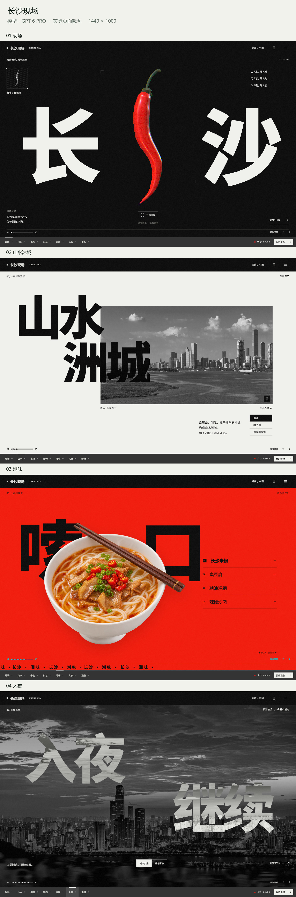
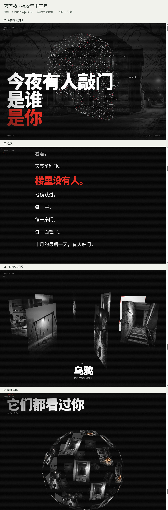
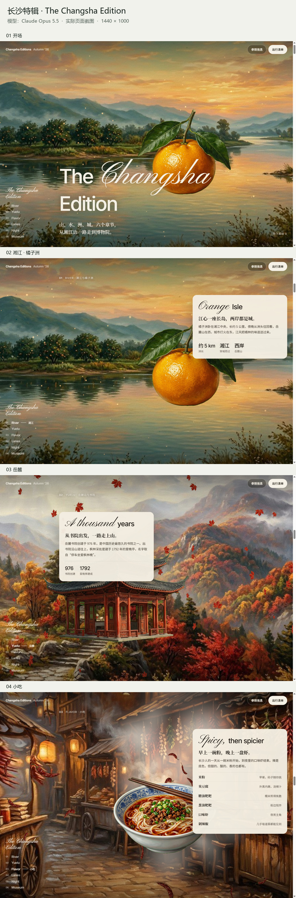

# 作品展示与截图来源

本页收录作者提供的六个作品。所有图片均来自实际浏览器截图，按场景等比缩放、拼接，没有重绘或修改页面内容。长图是精选场景拼接，不是连续的全页截图。滚动动画、拖拽、粒子和三维交互需要打开原作品体验。

截图日期：2026-11-04（Asia/Shanghai）。浏览器：Ego Lite；单屏视口：1440 × 1000。逐屏文件的摘要及来源记录见[manifest.json](screenshots/manifest.json)。截图所对应的制作版本与当前 skill v34 不一定相同，不将历史作品追认为 v34 的受控实验。

## DeepSeek 对照

两边的模型均为 **DeepSeek V4.1 Flash**。以下使用状态由作者在本次发布整理中确认。

| 项目 | 使用 skill | 未使用 skill |
|---|---|---|
| 模型 | DeepSeek V4.1 Flash | DeepSeek V4.1 Flash |
| 作品 | 长沙志 · 冬 2026 | 长沙志 · 城市版本 |
| 原始样本 ID | `000e433564488284` | `c73a2a18a05ddb58` |
| 作者提供的定位 | `index.html#shanshui` | `index.html#overview` |
| 本次截图章节 | 山水 / 文脉 / 烟火 | 山 / 文 / 味 |
| 长图 | [使用 skill](screenshots/deepseek-with-skill.jpg) | [未使用 skill](screenshots/deepseek-without-skill.jpg) |

两个原地址运行在作者本机的 `127.0.0.1`，外部读者无法直接访问，因此将截图保存在仓库中。未取得相同提示词、采样参数、耗时和完整生成记录，不宣称严格受控评测，也不根据截图推断模型版本。

## 长沙现场

[在线体验](https://changsha-city-fieldnotes.leir0491.chatgpt.site/#intro) · 模型：GPT 6 PRO

页面按章节切换，普通全页截图无法展现所有章节。本次实际切换到现场、山水、湘味、入夜后分别截图。

## 长沙 · 山水洲城

[在线体验](https://changsha-city-edition-v34.leir0491.chatgpt.site/#xiangjiang) · 模型：GPT 6 PRO

选取开场、湘江之畔、湘都风味三个场景。

## 万圣夜 · 槐安里十三号

[Hark 分享页](https://hark.com/site/6ea9e899-ceba-4306-966c-0622f3f47ee8?hark_region=us) · 模型：Claude Opus 5.5

分享外壳页本次停留在加载画面，改从该页实际嵌入的[作品地址](https://hark.site/s/6ea9e899-ceba-4306-966c-0622f3f47ee8/index.html?hark_region=us&via=app)打开，等待加载完成后截图。选取开场、档案、图像轮播和图像球体四个场景。

## 长沙特辑 · The Changsha Edition

[Hark 分享页](https://hark.com/site/77af0857-a085-4f73-9456-4db0641e3a45?hark_region=us) · 模型：Claude Opus 5.5

页面标题为「长沙特辑 · The Changsha Edition · Autumn '26」。从分享页实际嵌入的[作品地址](https://hark.site/s/77af0857-a085-4f73-9456-4db0641e3a45/index.html?hark_region=us&via=app)打开，选取开场、湘江与橘子洲、岳麓、小吃四个场景截图并拼接。

