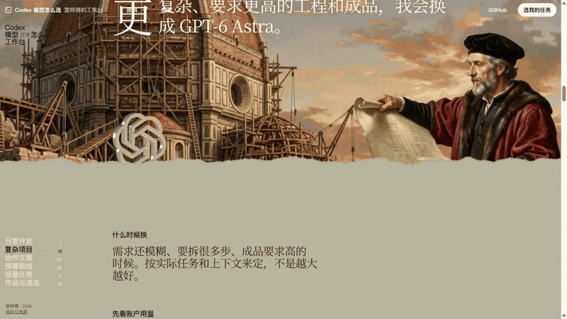
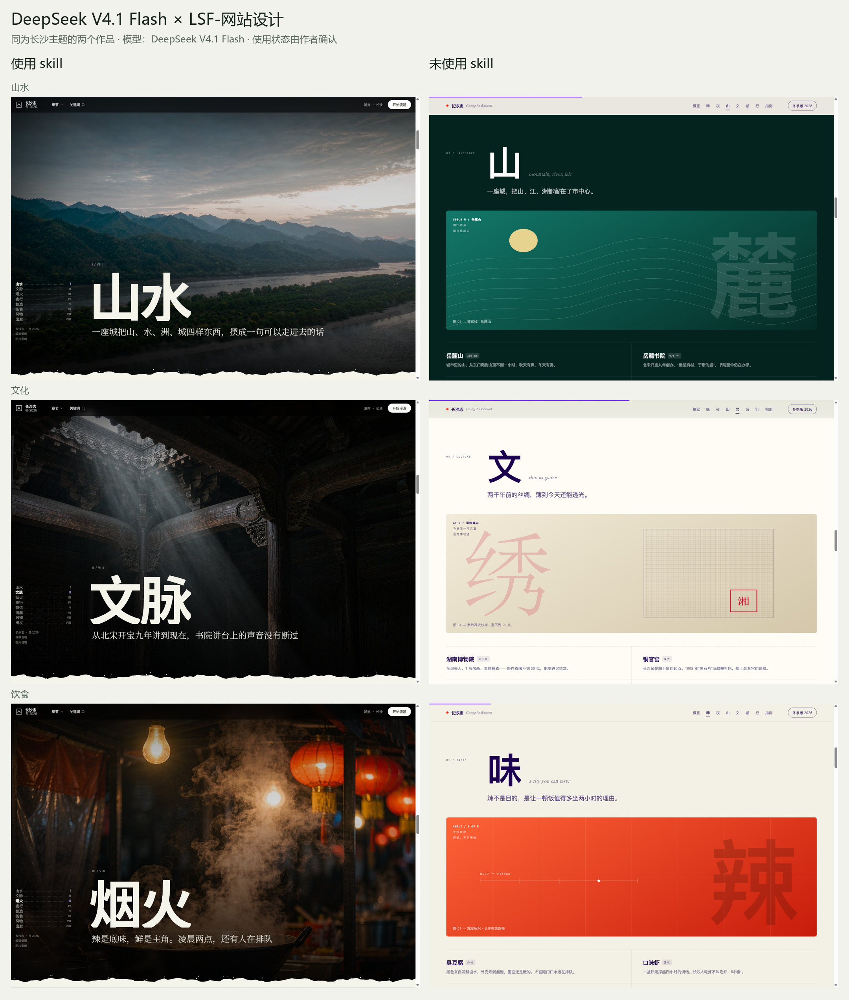

# 作品展示与截图来源

本页收录作者提供的七个作品。所有图片均来自实际浏览器截图，按场景等比缩放、拼接，没有重绘或修改页面内容。长图是精选场景拼接，不是连续的全页截图。滚动动画、拖拽、粒子和三维交互需要打开原作品体验。

截图日期：2026-11-04（Asia/Shanghai）。浏览器：Ego Lite；桌面截图视口：1440 × 1000，置顶案例另含 375 × 812 手机截图和 1440 × 810 录屏。逐屏文件的摘要及来源记录见[manifest.json](screenshots/manifest.json)。截图所对应的制作版本与当前 skill v34 不一定相同，不将历史作品追认为 v34 的受控实验。

## 置顶案例：Codex 模型怎么选

[在线体验](https://hark.com/site/6987019b-6557-46da-bf40-a0ed2d58dcfe?hark_region=us) · **制作模型：Claude Opus 5.5** · 雷师傅目前最满意的作品之一（作者评价）

页面标题为「Codex 模型怎么选 · 雷师傅的工作台」，从分享页实际嵌入的作品地址访问并等待场景加载。记录六章的画面、配置正文、模型选择器、搜索与手机目录；没有修改原站内容或重新生成画面。

### 实际操作录屏

[观看 / 下载约 39 秒 MP4](https://github.com/leishifu666/lsf-website-design/raw/refs/heads/main/examples/videos/codex-model-guide.mp4)。录屏顺序为开场滚动、日常开发及配置、其余五章、任务选择器、文案与复杂任务推荐、速度偏好、搜索 DeepSeek、返回日常章节。录屏没有配音。

GIF 是实际录屏中约 10 秒的加速节选；MP4 保留连续操作。视频输出 1440 × 810、30fps。详情与摘要见[录屏记录](videos/README.md)。

### 六章与长图

[查看九个场景长图](screenshots/codex-model-guide-long.jpg)。长图选取开场、六章、任务选择和搜索，不是连续全页截图。

### 独立截图

| 场景 | 截图 |
|---|---|
| 开场场景 | [查看](screenshots/codex-model-guide/01-opening.jpg) |
| 章节转场 | [查看](screenshots/codex-model-guide/02-transition.jpg) |
| 日常开发 | [查看](screenshots/codex-model-guide/03-daily.jpg) |
| 配置与正文 | [查看](screenshots/codex-model-guide/04-settings.jpg) |
| 复杂项目 | [查看](screenshots/codex-model-guide/05-complex.jpg) |
| 协作文案 | [查看](screenshots/codex-model-guide/06-copywriting.jpg) |
| 预算路线 | [查看](screenshots/codex-model-guide/07-budget.jpg) |
| 轻量任务 | [查看](screenshots/codex-model-guide/08-light.jpg) |
| 作品与选法 | [查看](screenshots/codex-model-guide/09-works.jpg) |
| 任务选择器 | [查看](screenshots/codex-model-guide/10-chooser.jpg) |
| 切换文案推荐 | [查看](screenshots/codex-model-guide/11-copy-choice.jpg) |
| 模型搜索 | [查看](screenshots/codex-model-guide/12-search.jpg) |
| 已有作品画廊 | [查看](screenshots/codex-model-guide/13-gallery.jpg) |
| 手机章节 | [查看](screenshots/codex-model-guide/14-mobile.jpg) |
| 手机目录 | [查看](screenshots/codex-model-guide/15-mobile-menu.jpg) |

实际操作确认：章节导航能跳转；选择“写文案”后结果变为 Gemini 3.1 Pro 候选与独立审核；DeepSeek 搜索返回对应模型；手机目录可打开和关闭。本次为作品展示取材，没有把这些操作写成全站功能验收或模型排名。

## DeepSeek 对照

两边的模型均为 **DeepSeek V4.1 Flash**。以下使用状态由作者在本次发布整理中确认。

| 项目 | 使用 skill | 未使用 skill |
|---|---|---|
| 模型 | DeepSeek V4.1 Flash | DeepSeek V4.1 Flash |
| 作品 | 长沙志 · 冬 2026 | 长沙志 · 城市版本 |
| 原始样本 ID | `000e433564488284` | `c73a2a18a05ddb58` |
| 作者提供的定位 | `index.html#shanshui` | `index.html#overview` |
| 本次截图章节 | 山水 / 文脉 / 烟火 | 山 / 文 / 味 |
| 长图 | [使用 skill](screenshots/deepseek-with-skill.jpg) | [未使用 skill](screenshots/deepseek-without-skill.jpg) |

两个原地址运行在作者本机的 `127.0.0.1`，外部读者无法直接访问，因此将截图保存在仓库中。未取得相同提示词、采样参数、耗时和完整生成记录，不宣称严格受控评测，也不根据截图推断模型版本。

## 长沙现场

[在线体验](https://changsha-city-fieldnotes.leir0491.chatgpt.site/#intro) · 模型：GPT 6 PRO

页面按章节切换，普通全页截图无法展现所有章节。本次实际切换到现场、山水、湘味、入夜后分别截图。

## 长沙 · 山水洲城

[在线体验](https://changsha-city-edition-v34.leir0491.chatgpt.site/#xiangjiang) · 模型：GPT 6 PRO

选取开场、湘江之畔、湘都风味三个场景。

## 万圣夜 · 槐安里十三号

[Hark 分享页](https://hark.com/site/6ea9e899-ceba-4306-966c-0622f3f47ee8?hark_region=us) · 模型：Claude Opus 5.5

分享外壳页本次停留在加载画面，改从该页实际嵌入的[作品地址](https://hark.site/s/6ea9e899-ceba-4306-966c-0622f3f47ee8/index.html?hark_region=us&via=app)打开，等待加载完成后截图。选取开场、档案、图像轮播和图像球体四个场景。

## 长沙特辑 · The Changsha Edition

[Hark 分享页](https://hark.com/site/77af0857-a085-4f73-9456-4db0641e3a45?hark_region=us) · 模型：Claude Opus 5.5

页面标题为「长沙特辑 · The Changsha Edition · Autumn '26」。从分享页实际嵌入的[作品地址](https://hark.site/s/77af0857-a085-4f73-9456-4db0641e3a45/index.html?hark_region=us&via=app)打开，选取开场、湘江与橘子洲、岳麓、小吃四个场景截图并拼接。

