# 作品展示与截图来源

本页收录 `LSF-网站设计` 的 11 组真实网页案例，按主题与对照维度分为四类。所有图片与 GIF 均来自实际浏览器截图或页面操作连续截帧，按场景等比缩放、拼接，未对网页内容进行重绘。

- 桌面截图视口：`1440 × 1000`（置顶案例另含 `375 × 812` 手机截图与 `1440 × 810` 录屏）
- 截图目录结构：`codex-model-guide/`、`leishifu-coffee/`、`deepseek-comparison/`、`cases/`
- 逐图摘要、哈希与来源记录：[manifest.json](screenshots/manifest.json)

---

## 目录

- [一、置顶案例：Codex 模型怎么选（Claude Opus 5.5）](#一置顶案例codex-模型怎么选claude-opus-55)
- [二、同主题双模型对照：雷师傅咖啡（Claude Opus 5.5 vs GPT6 Pro）](#二同主题双模型对照雷师傅咖啡claude-opus-55-vs-gpt6-pro)
- [三、同模型对照：DeepSeek V4.1 Flash（使用 vs 未使用 Skill）](#三同模型对照deepseek-v41-flash使用-vs-未使用-skill)
- [四、更多精选作品（城市专题与创意展示）](#四更多精选作品城市专题与创意展示)

---

## 一、置顶案例：Codex 模型怎么选（Claude Opus 5.5）

[在线体验](https://hark.com/site/6987019b-6557-46da-bf40-a0ed2d58dcfe?hark_region=us) · **制作模型：Claude Opus 5.5** · 雷师傅目前最满意的作品之一（作者评价）

页面标题为「Codex 模型怎么选 · 雷师傅的工作台」，记录六章画面、配置正文、任务选择器、模型搜索与手机目录。

[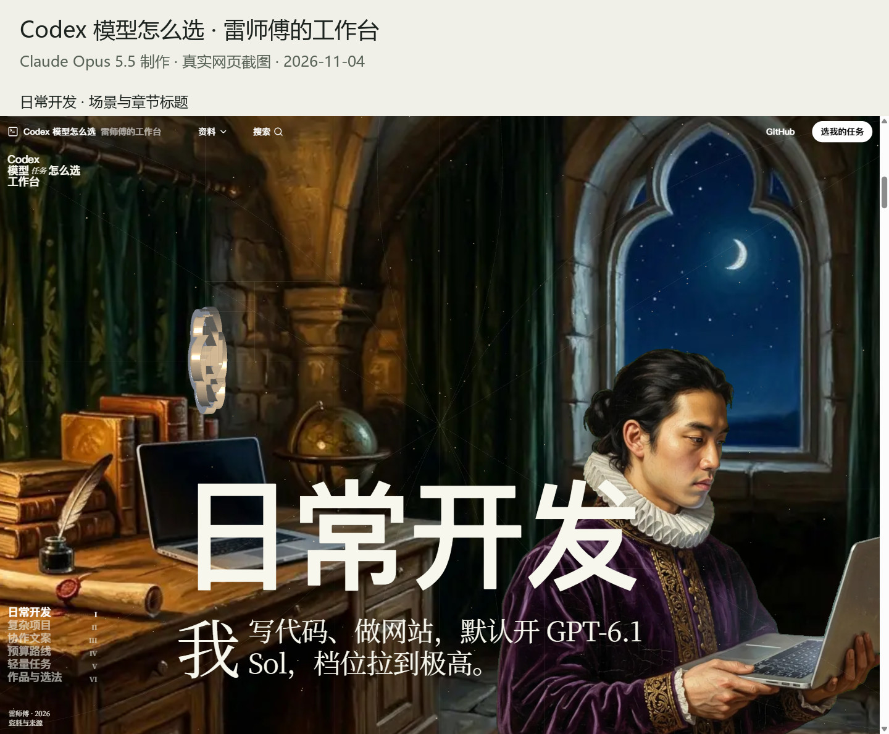](https://hark.com/site/6987019b-6557-46da-bf40-a0ed2d58dcfe?hark_region=us)

### 实际操作录屏与动态预览

[观看 / 下载约 39 秒 MP4](https://github.com/leishifu666/lsf-website-design/raw/refs/heads/main/examples/videos/codex-model-guide.mp4)（`1440 × 810`、30fps、无音频）。详情与动作时间戳见[录屏记录](videos/README.md)。

[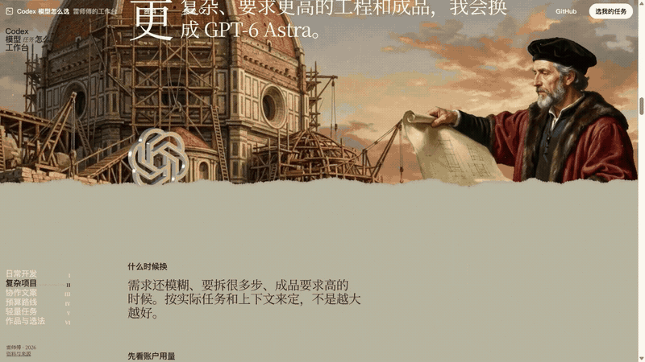](https://github.com/leishifu666/lsf-website-design/raw/refs/heads/main/examples/videos/codex-model-guide.mp4)

### 六章与长图

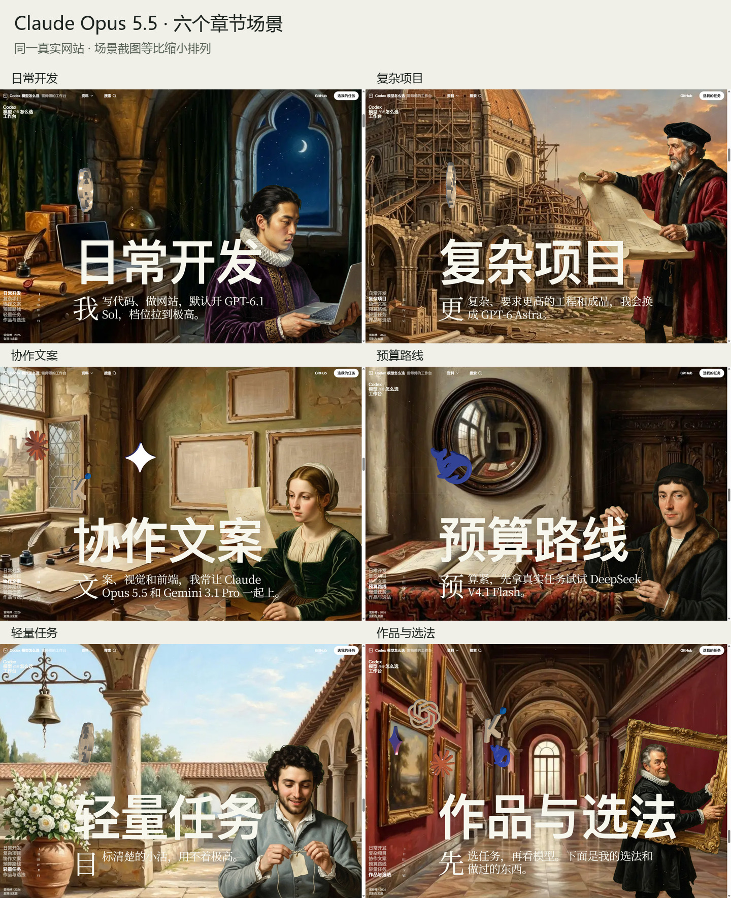

[查看九个场景长图](screenshots/codex-model-guide/long.jpg)。

### 独立截图（15 张）

| 场景 | 截图 | 场景 | 截图 |
|---|---|---|---|
| 开场场景 | [查看](screenshots/codex-model-guide/01-opening.jpg) | 章节转场 | [查看](screenshots/codex-model-guide/02-transition.jpg) |
| 日常开发 | [查看](screenshots/codex-model-guide/03-daily.jpg) | 配置与正文 | [查看](screenshots/codex-model-guide/04-settings.jpg) |
| 复杂项目 | [查看](screenshots/codex-model-guide/05-complex.jpg) | 协作文案 | [查看](screenshots/codex-model-guide/06-copywriting.jpg) |
| 预算路线 | [查看](screenshots/codex-model-guide/07-budget.jpg) | 轻量任务 | [查看](screenshots/codex-model-guide/08-light.jpg) |
| 作品与选法 | [查看](screenshots/codex-model-guide/09-works.jpg) | 任务选择器 | [查看](screenshots/codex-model-guide/10-chooser.jpg) |
| 切换文案推荐 | [查看](screenshots/codex-model-guide/11-copy-choice.jpg) | 模型搜索 | [查看](screenshots/codex-model-guide/12-search.jpg) |
| 已有作品画廊 | [查看](screenshots/codex-model-guide/13-gallery.jpg) | 手机章节 | [查看](screenshots/codex-model-guide/14-mobile.jpg) |
| 手机目录 | [查看](screenshots/codex-model-guide/15-mobile-menu.jpg) | — | — |

---

## 二、同主题双模型对照：雷师傅咖啡（Claude Opus 5.5 vs GPT6 Pro）

两份作品均以「雷师傅咖啡」为主题（2026-11-21 在 `1440 × 1000` 桌面视口实拍），分别由 **Claude Opus 5.5** 与 **GPT6 Pro** 制作，直观展现同一品牌主题下不同旗舰模型的视觉取向、3D 罐体渲染与交互设计。

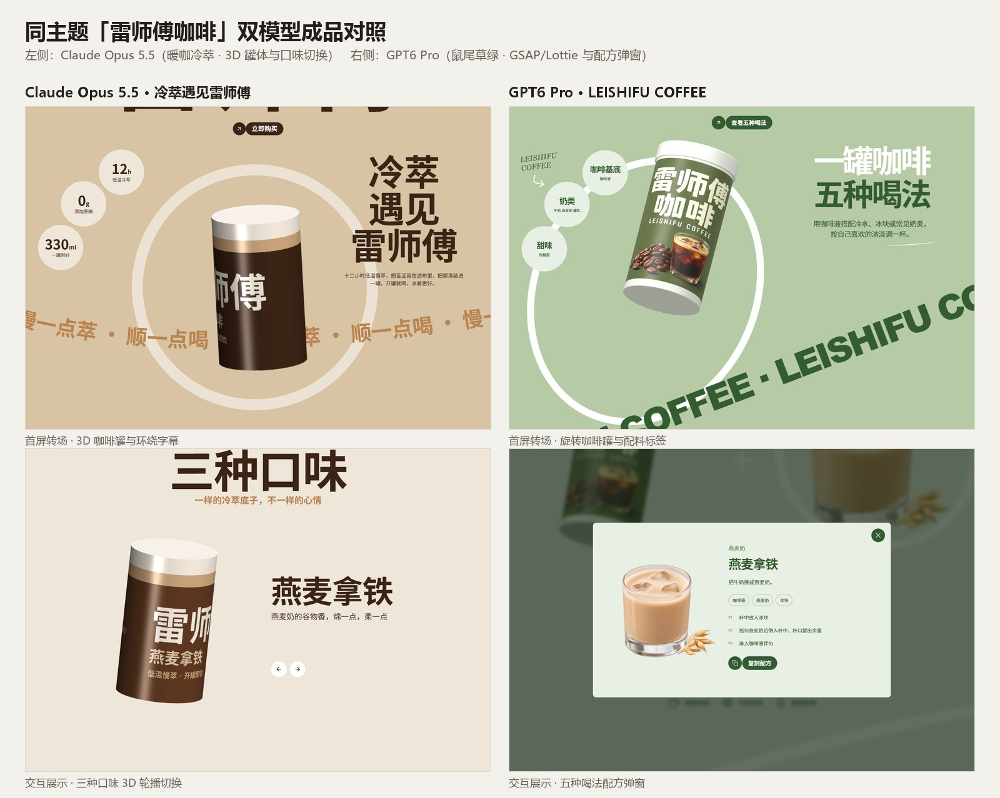

| 维度 | Claude Opus 5.5 · 冷萃遇见雷师傅 | GPT6 Pro · LEISHIFU COFFEE |
|---|---|---|
| 在线体验 | [打开 Hark 作品](https://hark.com/site/7aceefbc-de78-4c5b-9c8f-b8391929c674?hark_region=us)（[直达页面](https://hark.site/s/7aceefbc-de78-4c5b-9c8f-b8391929c674/index.html?hark_region=us&via=app)） | [打开作品](https://leishifu-coffee-76b741.leir0491.chatgpt.site/#top) |
| 视觉配色 | 暖米卡其、奶油白与深烘咖色 | 鼠尾草绿、森林绿与浅灰绿 |
| 交互与动效 | 超大首屏字滚动揭幕、双 `<canvas>` 程序化 3D 罐体、三口味 3D 轮播 | GSAP + Lottie 滚动驱动、旋转罐体、倾斜要点卡、五喝法轮播与配方弹窗 |
| 动态预览 | [查看 GIF](screenshots/leishifu-coffee/opus-preview.gif) | [查看 GIF](screenshots/leishifu-coffee/gpt6-preview.gif) |
| 六场景拼图 | [查看拼图](screenshots/leishifu-coffee/opus-scenes.jpg) | [查看拼图](screenshots/leishifu-coffee/gpt6-scenes.jpg) |

### 1. Claude Opus 5.5 · 雷师傅咖啡（冷萃版）

页面包含首屏大字揭幕、环形框 3D 咖啡罐与环绕标语、3 段嵌入式视频卡片、卖点卡片与旋转罐体、冷萃 vs 热冲速溶对比表、口碑征集卡片轮播、以及支持切换的「三种口味（冷萃咖啡 / 燕麦拿铁 / 焦糖美式）」3D 轮播。

[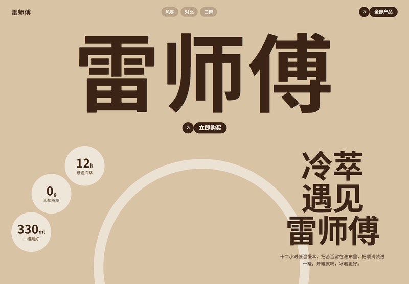](https://hark.com/site/7aceefbc-de78-4c5b-9c8f-b8391929c674?hark_region=us)

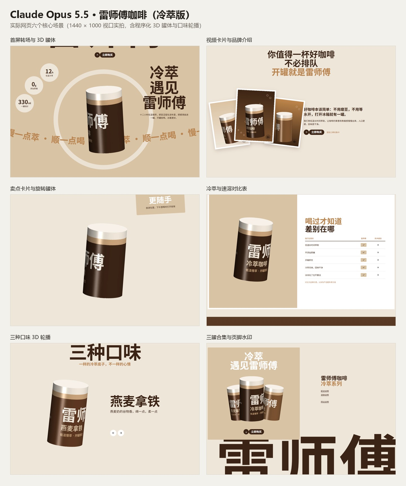

| 场景 | 截图 | 场景 | 截图 |
|---|---|---|---|
| 01 首屏转场与 3D 罐体 | [查看](screenshots/leishifu-coffee/opus/01-hero.jpg) | 02 视频卡片与品牌介绍 | [查看](screenshots/leishifu-coffee/opus/02-lifestyle.jpg) |
| 03 卖点卡片与旋转罐体 | [查看](screenshots/leishifu-coffee/opus/03-features.jpg) | 04 冷萃与速溶对比表 | [查看](screenshots/leishifu-coffee/opus/04-comparison.jpg) |
| 05 三种口味 3D 轮播 | [查看](screenshots/leishifu-coffee/opus/05-flavors.jpg) | 06 三罐合集与页脚水印 | [查看](screenshots/leishifu-coffee/opus/06-footer.jpg) |

### 2. GPT6 Pro · 雷师傅咖啡（五种喝法概念版）

页面以「一罐咖啡，五种喝法」为主线，包含首屏旋转咖啡罐与配料标签、3 段咖啡视频卡片、4 张倾斜搭配卡片、7 项「黑咖 vs 奶咖」对比表、6 条调配笔记 Embla 轮播，以及支持点击打开配料步骤弹窗的「五种喝法配方（原味黑咖 / 冰拿铁 / 燕麦拿铁 / 椰乳拿铁 / 焦糖拿铁）」轮播。

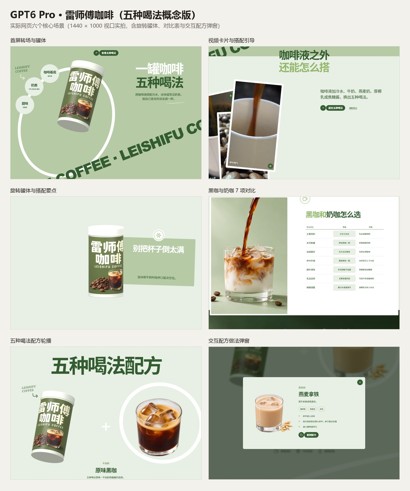

| 场景 | 截图 | 场景 | 截图 |
|---|---|---|---|
| 01 首屏转场与罐体 | [查看](screenshots/leishifu-coffee/gpt6/01-hero.jpg) | 02 视频卡片与搭配引导 | [查看](screenshots/leishifu-coffee/gpt6/02-videos.jpg) |
| 03 旋转罐体与搭配要点 | [查看](screenshots/leishifu-coffee/gpt6/03-tips.jpg) | 04 黑咖与奶咖 7 项对比 | [查看](screenshots/leishifu-coffee/gpt6/04-comparison.jpg) |
| 05 五种喝法配方轮播 | [查看](screenshots/leishifu-coffee/gpt6/05-recipes.jpg) | 06 交互配方做法弹窗 | [查看](screenshots/leishifu-coffee/gpt6/06-modal.jpg) |
| 07 页脚卡片与超大水印 | [查看](screenshots/leishifu-coffee/gpt6/07-footer.jpg) | — | — |

---

## 三、同模型对照：DeepSeek V4.1 Flash（使用 vs 未使用 Skill）

两边的模型均为 **DeepSeek V4.1 Flash**，主题均为长沙。使用状态由作者确认。

| 项目 | 使用 skill | 未使用 skill |
|---|---|---|
| 模型 | DeepSeek V4.1 Flash | DeepSeek V4.1 Flash |
| 作品 | 长沙志 · 冬 2026 | 长沙志 · 城市版本 |
| 原始样本 ID | `000e433564488284` | `c73a2a18a05ddb58` |
| 作者提供的定位 | `index.html#shanshui` | `index.html#overview` |
| 本次截图章节 | 山水 / 文脉 / 烟火 | 山 / 文 / 味 |
| 长图 | [使用 skill](screenshots/deepseek-comparison/with-skill.jpg) | [未使用 skill](screenshots/deepseek-comparison/without-skill.jpg) |

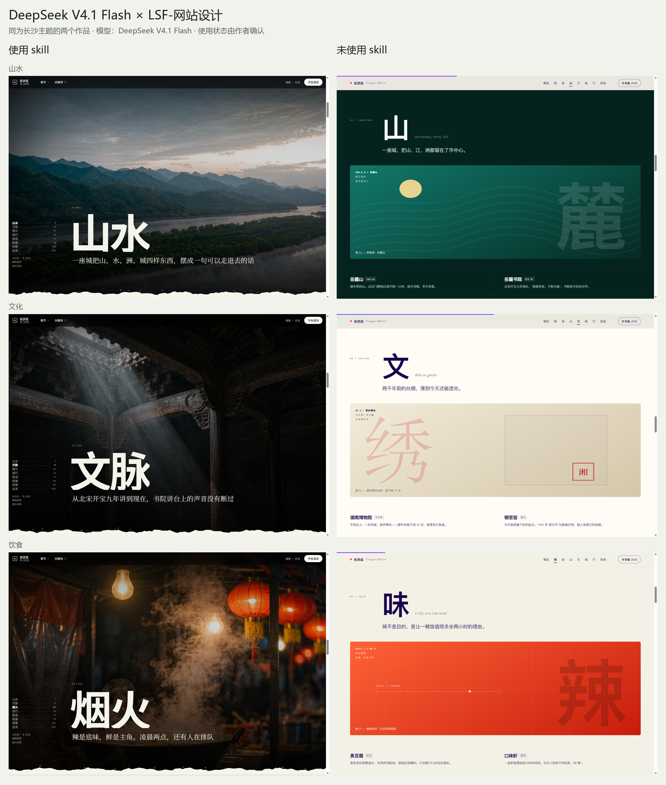

两个原地址运行在作者本机的 `127.0.0.1`，外部读者无法直接访问，因此将截图保存在仓库中。未取得相同提示词、采样参数、耗时和完整生成记录，不宣称严格受控评测，也不根据截图推断模型版本。

---

## 四、更多精选作品（城市专题与创意展示）

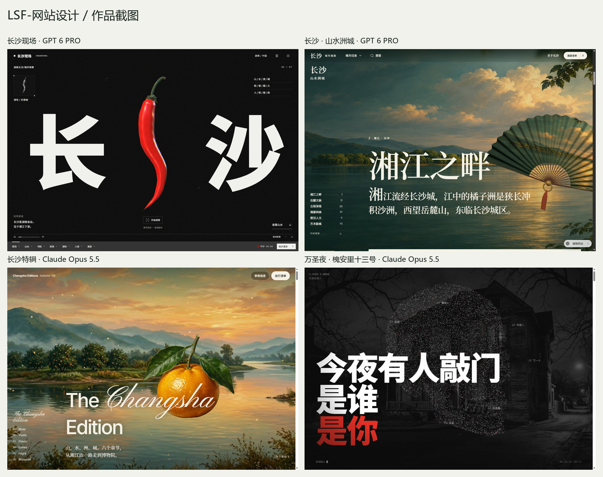

### 山水洲城 · 长沙漫游

[在线体验](https://changsha-shanshui-edition-2026.leir0491.chatgpt.site/#overview) · **制作模型：GPT6 Pro** · 作者确认使用了 **LSF-网站设计**

从湘江出发，依次浏览湘江、岳麓、城事、街巷、寻味和入夜六个篇章，另提供地点索引和「我的漫游」。2026-11-19 实拍。

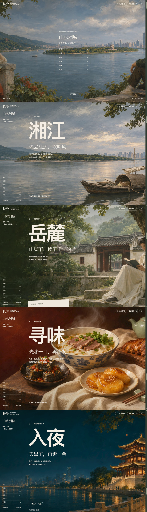

### 长沙现场

[在线体验](https://changsha-city-fieldnotes.leir0491.chatgpt.site/#intro) · **制作模型：GPT6 Pro**

页面按章节切换，分别截取现场、山水、湘味、入夜四个场景。

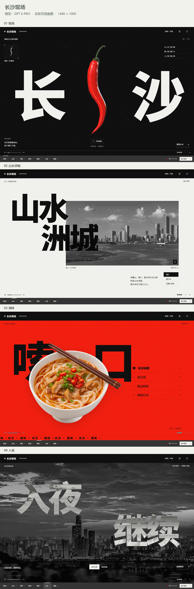

### 长沙 · 山水洲城

[在线体验](https://changsha-city-edition-v34.leir0491.chatgpt.site/#xiangjiang) · **制作模型：GPT6 Pro**

选取开场、湘江之畔、湘都风味三个场景。

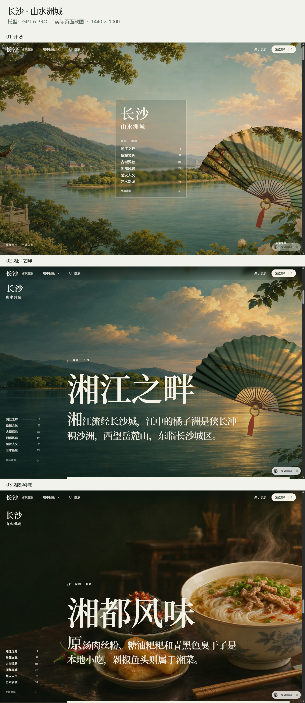

### 万圣夜 · 槐安里十三号

[Hark 分享页](https://hark.com/site/6ea9e899-ceba-4306-966c-0622f3f47ee8?hark_region=us)（[作品直达](https://hark.site/s/6ea9e899-ceba-4306-966c-0622f3f47ee8/index.html?hark_region=us&via=app)） · **制作模型：Claude Opus 5.5**

选取开场、档案、图像轮播和图像球体四个场景。

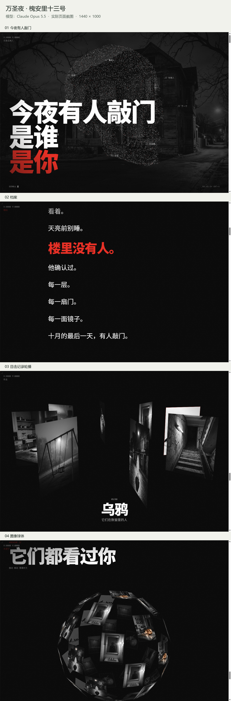

### 长沙特辑 · The Changsha Edition

[Hark 分享页](https://hark.com/site/77af0857-a085-4f73-9456-4db0641e3a45?hark_region=us)（[作品直达](https://hark.site/s/77af0857-a085-4f73-9456-4db0641e3a45/index.html?hark_region=us&via=app)） · **制作模型：Claude Opus 5.5**

选取开场、湘江与橘子洲、岳麓、小吃四个场景截图并拼接。

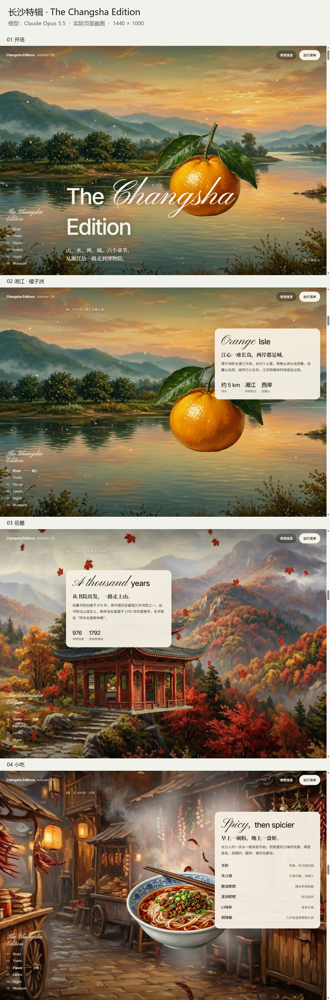

### 狼艺复兴版 · 狼人杀

[Hark 分享页](https://hark.com/site/533df3ba-5c81-45b2-9d92-50281fb04326?hark_region=us)（[作品直达](https://hark.site/s/533df3ba-5c81-45b2-9d92-50281fb04326/index.html?hark_region=us&via=app)） · **制作模型：Claude Opus 5.5**

按章节展示角色、白天投票和常见配置。2026-11-20 实拍，收录开场、首屏转场、狼人、女巫、白天与投票和常见配置六个场景。

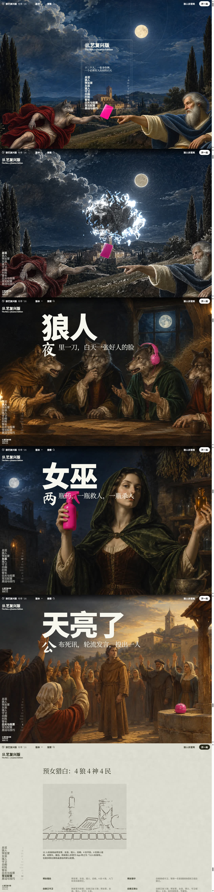
